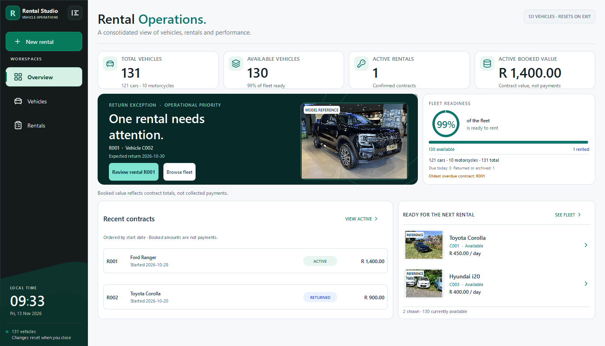

# Rental Studio 2.0

An offline Windows desktop app for running a fictional vehicle rental operation. It brings fleet availability, rental quotes, bookings and returns into three workspaces. The portfolio demo includes **131 fictional vehicles across 70 model families**.

## Watch the rental walkthrough

The 67-second demo plays automatically. Follow the Corolla from quote and booking through return, contract history and restored availability.

[Download the MP4](https://raw.githubusercontent.com/Sonkhe-Shongwe/VehicleRentalSystem/d859b4d0945db0c7114cd1864b489016785265f5/docs/media/rental-walkthrough.mp4) · [Browse the Windows screenshots](docs/screenshots/README.md)

## What I built

I started this project as a university assignment using Qt Widgets and developed it into a Qt Quick desktop application. I organised Overview, Vehicles and Rentals around the same C++ domain so a booking or return is reflected across all three. QML handles interaction and presentation, while C++ validates quotes, manages availability and commits rental changes. I also built an opt-in SQLite Lab to demonstrate transactions and rollback with a separate fictional dataset.

## What happens when a quote goes stale?

Suppose the operator reviews a three-day quote at R 450 per day, then the rate changes to R 500. At confirmation, the C++ service recalculates the quote from current vehicle data and requires a fresh review. The regression test checks that rejecting the R 1,350 quote leaves the vehicle unreserved and creates no rental record. A fresh preview shows R 1,500.

[Confirmation service](src/application/rental_confirm_service.cpp) · [Stale-quote regression test](tests/p3_rental_confirm_tests.cpp) · [Architecture](docs/ARCHITECTURE.md)

## Try the workflow

1. In **Overview**, review fleet availability and the rental flagged for attention.
2. In **Vehicles**, search for the available Toyota Corolla `C001`. Select it and choose **Book selected vehicle**.
3. Set the rental duration to three days and select **Preview C++ quote**. Enter **Fictional Demo Customer** and **0000000000**, then select **Confirm booking**.
4. In **Rentals**, select the new contract. Choose **Return selected rental**, then **Confirm return**. Open **History** to see the returned contract. In **Vehicles**, `C001` is available again.

The standard session resets on exit. To run the separate **SQLite Lab**, launch with `--p7-fictional-sql-lab` and open **SQLite Lab** in the sidebar. Its five actions take a generated vehicle from quote and booking through return, archive and retirement.

## Build and test

1. Clone this repository and open the root `CMakeLists.txt` in **Qt Creator**.
2. Select a **64-bit Qt 6.8.3 or later MinGW desktop kit** with Widgets, Quick, Quick Controls, Quick Dialogs, SQL, Test and SVG support. Use the `rental-studio-local` preset.
3. Select **`rental_studio_qtquick_spike`** as the run target. This is the current Qt Quick app. The **`VehicleRentalSystem_A3`** target is the original Widgets application. Launch without arguments to open the standard 131-vehicle demo.

[Native CI and test instructions](docs/TESTING.md) · [Image and icon credits](docs/ASSET_CREDITS.md)

## Start here in the code

| Area | Entry point |
| --- | --- |
| Qt Quick workspaces, navigation and dialogs | [Main.qml](spikes/qtquick_p2/Main.qml) |
| Booking and return services | [src/application](src/application) |
| Availability, rental state and local persistence | [rentalsystem.cpp](rentalsystem.cpp) |
| Isolated SQLite lifecycle and constraints | [sqlite_repository.h](src/application/p7_sandbox/sqlite_repository.h) |
| Booking, return and rollback regression tests | [tests](tests) |
