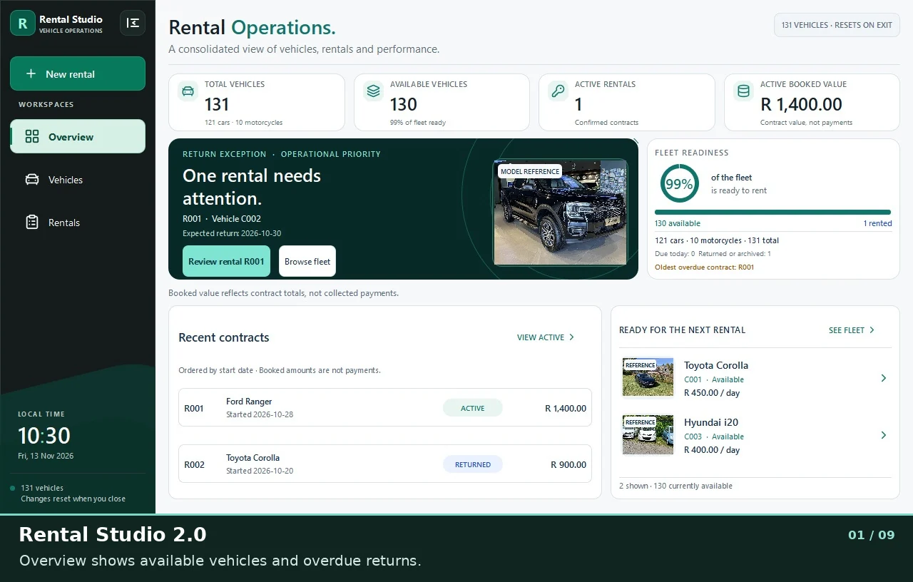

# Rental Studio 2.0

Rental Studio is a personal Windows desktop application for managing vehicles, bookings and returns. It runs offline and is built with C++17 and Qt Quick. The demo includes 131 fictional vehicles across 70 model families.

[Build from source](#build-from-source) · [Screenshots](docs/screenshots/README.md) · [Architecture](docs/ARCHITECTURE.md) · [Testing](docs/TESTING.md)

## Demo

[Download the 67-second MP4](https://raw.githubusercontent.com/Sonkhe-Shongwe/VehicleRentalSystem/docs/portfolio-source-handoff/docs/media/rental-walkthrough.mp4)

## Build from source

1. Clone this repository and open the root `CMakeLists.txt` in Qt Creator.
2. Select a 64-bit Qt 6 desktop kit with Widgets, Quick, Quick Controls, Quick Dialogs, SQL, Test and SVG. The CI build uses Qt 6.8.3. For a Windows MinGW build, use a Qt kit built for MinGW.
3. Select the `rental-studio-local` CMake preset. Build and run the `rental_studio_qtquick_spike` target. `VehicleRentalSystem_A3` is the original Qt Widgets target.

## Try a rental

1. In **Vehicles**, search for `C001`, select the Toyota Corolla and choose **Book selected vehicle**.
2. Set the duration to three days and choose **Preview quote**. Enter **Demo Customer** and **0000000000**, then choose **Confirm booking**.
3. In **Rentals**, select the new contract and choose **Return selected rental**, then **Confirm return**. The contract appears in **History** and the Corolla is available again.

The standard demo resets when the app closes. To try the separate SQLite Lab, launch with `--p7-fictional-sql-lab` and open **SQLite Lab** in the sidebar. It uses a temporary database with its own sample data.

[Asset credits](docs/ASSET_CREDITS.md)
