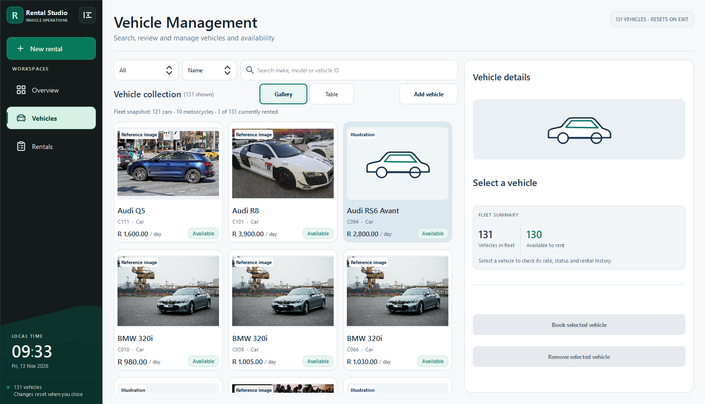
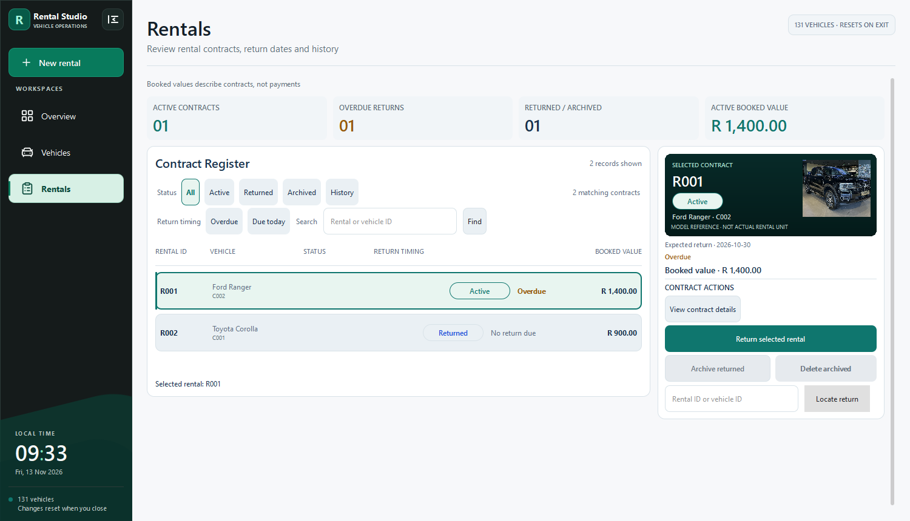
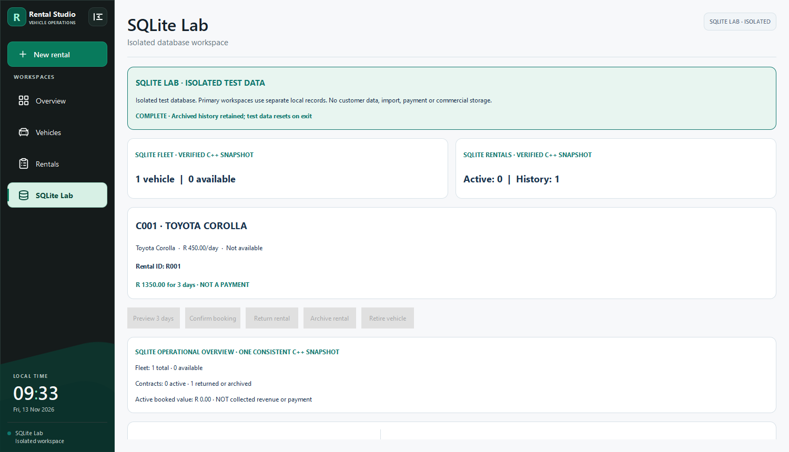

# Rental Studio on Windows

These are unedited captures of the compiled Qt application running with fictional records. The [native CI run](https://github.com/Sonkhe-Shongwe/VehicleRentalSystem/actions/runs/43401498487) generated them from portfolio commit `0438d89bbc7cd266752606feed251114e8c1e51f` using Qt 6.8.3 and MSVC. The PNGs are stored in this repository. See [asset credits](../ASSET_CREDITS.md) for the model-reference photos.

| Screen | 1500 × 860 | 1280 × 720 |
| --- | --- | --- |
| Overview | [Wide](overview-1500x860.png) | [Compact](overview-1280x720.png) |
| Vehicles | [Wide](vehicles-1500x860.png) | [Compact](vehicles-1280x720.png) |
| Rentals | [Wide](rentals-1500x860.png) | [Compact](rentals-1280x720.png) |
| SQLite Lab | [Wide](sqlite-lab-1500x860.png) | [Compact](sqlite-lab-1280x720.png) |

## Vehicles

The gallery keeps the search, view switch and inspector visible at both sizes. It uses three columns in the wide window and two in the compact window. Cards label photos as references and silhouettes as illustrations.

## Rentals

The register and selected contract stay side by side. The return action is visible, and Archive and Delete are disabled for the selected active contract. Booked value is described as contract value on screen.

## SQLite Lab

The completed demonstration shows zero active contracts and one historical contract. The lower record explorers are below the initial viewport.

